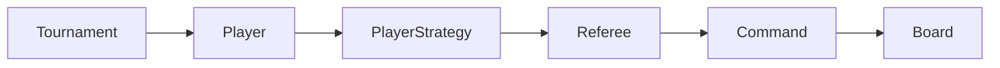

# Java Puzzle Tournament

A small Java console project based on the university OOP assignment **“Turniej gry w układankę”** (January 29, 2025), extended with JUnit tests and a strategy comparison.

Players transform an `n × n` binary board into all ones using reversible commands. Five strategies compete in a single-elimination tournament; fewer commands wins.

- Eight basic operations and composites, with exact undo and retained history.
- Independent copies of one shared starting board per tournament round.
- Seeded randomness, registration-order tie-breaking, and automatic byes.
- Java 17, Maven, JUnit 5, and GitHub Actions; no runtime dependencies.



## Build and run

Install JDK 17 (or 21) and Maven 3.9+, then run from this directory:

```bash
mvn verify
java -jar target/java-puzzle-tournament-1.0.0.jar tournament 42
java -jar target/java-puzzle-tournament-1.0.0.jar compare 42
```

The last argument is the random seed. No arguments runs the tournament with seed 42. Run tests alone with `mvn test`. CI runs `mvn --batch-mode verify`, which tests and packages the application.

Example output from the verified seed-42 run (earlier rounds omitted):

```text
Round 3 — board 87x87
  Greedy (3823) vs Advanced (468) -> Advanced
Winner: Advanced
```

## Strategies and scoring

| Strategy | Behavior |
| --- | --- |
| Random | Chooses random valid basic operations or prepared composites. |
| Cautious | Random play; after each executed command, schedules undo with 20% probability. |
| Systematic | Sets every cell to one in row order; always performs `n²` commands. |
| Greedy | Visits cells in row order and sets only zeros to one. |
| Advanced | Sorts rows, flips columns with a strict majority of zeros, then sets remaining zeros. |

The command budget is `n²`. An unsolved game scores `n² + 1`. Each composite counts once. Each undo also consumes one budget unit; it does not erase the cost of the original command. The 20% probability and undo accounting are documented implementation choices. Except for Systematic's required full schedule, games stop when solved. See [precise rules and design](docs/design.md).

## Undo

The referee rejects actions after termination, keeps all executed commands, and marks undone entries with their action numbers. A separate stack identifies the latest command still eligible for undo. Commands save only the information they need: one cell, one row/column, or one diagonal. Flips and rotations use inverse operations; composites undo their components in reverse order. Command objects are single-use, and undo must target the same board.

## Measured comparison

One local run used seed **42**, twenty shared random **10×10** boards, Temurin OpenJDK 17.0.20.1, and `System.nanoTime()`. Scores and solve rates reproduce with the same seed; timings vary.

| Strategy | Average score | Solved | Average elapsed ms/game |
| --- | ---: | ---: | ---: |
| Random | 101.00 | 0% | 1.980 |
| Cautious | 101.00 | 0% | 0.883 |
| Systematic | 100.00 | 100% | 0.182 |
| Greedy | 48.60 | 100% | 0.114 |
| Advanced | 25.50 | 100% | 0.140 |

Scores count game actions; elapsed time measures preparation and game execution, including board copies and solved checks. Board generation and printing are excluded. This small experiment has no warm-up or statistical analysis and does not establish universal optimality or reliable speed rankings.

The tests cover commands and undo, composite restrictions, strategy phases, score limits, equal starting boards, ties, byes, and tournament outcomes. See the [pre-publication audit](docs/report.md) for the project structure, complexity, and checks performed.
