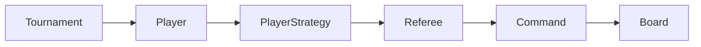

# Java Puzzle Tournament

Players transform an `n × n` binary board into all ones using reversible commands. Five strategies compete in a single-elimination tournament; fewer commands wins.

- Eight basic operations and composites, with exact undo and retained history.
- Independent copies of one shared starting board per tournament round.
- Seeded randomness, registration-order tie-breaking, and automatic byes.



## Build and run

Install JDK 27 and Maven 3.9+, then run from this directory:

```bash
mvn verify
java -jar target/java-puzzle-tournament-1.0.0.jar tournament 42
java -jar target/java-puzzle-tournament-1.0.0.jar compare 42
```

The last argument is the random seed. No arguments runs the tournament with seed 42. Run tests alone with `mvn test`. CI runs `mvn --batch-mode verify`, which tests and packages the application.

Example output from the verified seed-42 run (earlier rounds omitted):

```text
Round 3 — board 87x87
  Greedy (3823) vs Advanced (468) -> Advanced
Winner: Advanced
```

## Strategies and scoring

| Strategy | Behavior |
| --- | --- |
| Random | Chooses random valid basic operations or prepared composites. |
| Cautious | Random play; after each executed command, schedules undo with 20% probability. |
| Systematic | Sets every cell to one in row order; always performs `n²` commands. |
| Greedy | Visits cells in row order and sets only zeros to one. |
| Advanced | Sorts rows, flips columns with a strict majority of zeros, then sets remaining zeros. |

The command budget is `n²`. An unsolved game scores `n² + 1`. Each composite counts once. Each undo also consumes one budget unit; it does not erase the cost of the original command. The 20% probability and undo accounting are documented implementation choices. Except for Systematic's required full schedule, games stop when solved. See [precise rules and design](docs/design.md).

## Undo

The referee rejects actions after termination, keeps all executed commands, and marks undone entries with their action numbers. A separate stack identifies the latest command still eligible for undo. Commands save only the information they need: one cell, one row/column, or one diagonal. Flips and rotations use inverse operations; composites undo their components in reverse order. Command objects are single-use, and undo must target the same board.

## Example strategy comparison

The following results use seed **42** and **100 random 10×10 boards**. Each strategy plays on an independent copy of the same starting boards. Scores and solve rates reproduce with the same seed.

| Strategy | Average score | Solved |
| --- | ---: | ---: |
| Random | 101.00 | 0% |
| Cautious | 101.00 | 0% |
| Systematic | 100.00 | 100% |
| Greedy | 49.06 | 100% |
| Advanced | 25.92 | 100% |

Lower scores are better. On a 10×10 board, the action budget is 100 and every unsuccessful game scores 101, regardless of how close it came to solving the board. Systematic always uses 100 actions; Greedy uses one action per initial zero. Advanced can change multiple cells with a single action.

These results describe this sample only; they do not establish a general strategy ranking or optimality. Elapsed times are omitted because a single run without JVM warm-up or repeated measurements does not provide a reliable performance comparison.

The tests cover commands and undo, composite restrictions, strategy phases, score limits, equal starting boards, ties, byes, and tournament outcomes.
