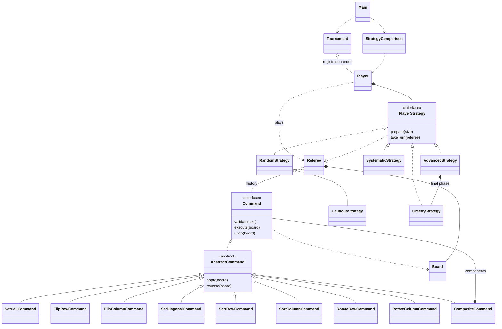

# Design and rules

## Specification and explicit interpretations

1. `Board` uses `boolean[][]`: false is zero, true is one. Java coordinates are zero-based. Sizes must be positive; sizes for which `n² + 1` overflows `int` are rejected. Tournament sizes are uniformly chosen from 10 through 100 inclusive. Generated cells use `Random.nextBoolean()`.
2. A referee accepts at most `n²` actions. A successful score is the number of actions; an unsuccessful score is `n² + 1`. Invalid commands and empty undo attempts throw an exception without using budget or changing history.
3. **Undo accounting is an interpretation:** an undo consumes one action and never refunds an executed command. This makes cautious games terminate within the same budget. Undo reverses the latest command still active. The execution history retains undone commands, with execution and undo action numbers; the active stack removes only eligibility for future undo. There is no redo.
4. Systematic explicitly performs all `n²` sets, including cells already equal to one. All other strategies stop as soon as a top-level action leaves the board solved, including initially solved boards (score zero). A pending cautious undo is not performed after the game has ended. Advanced also stops if it solves the board during an earlier phase.
5. Cautious uses a seeded random draw after each ordinary top-level execution (including composites). With probability 0.20, its next action is undo if available. An undo does not schedule another undo. A pending undo at the budget boundary is not performed. The probability is fixed at 20% for this implementation.
6. Each composite has at least one component, valid coordinates for its declared size, no nested composites, and no repeated basic operation family. The eight concrete basic command classes define those families; row/column indices, values, and diagonal choice do not define new types. All components run even if an intermediate board is solved. Only the final state is scored. Components undo in reverse order.
7. Random chooses uniformly among the eight basic families and composites. Random composites contain two different randomly chosen basic families. At preparation, it creates `n²` composites using only the known size, sufficient for the maximum possible number of turns. Unused composites are discarded at the next preparation. This straightforward bounded queue avoids constructing composites after seeing cells. Composite length and selection distribution are implementation choices.
8. Players register in order and need unique nonblank identifiers. Every round has one size and one starting board for all matches. Referees copy the board, keeping games independent. Winners stay in bracket order, so the first player in each match is always registered earlier. Lower score wins; ties choose that first player. The last player receives a bye when the remaining count is odd. Zero entrants is an error; one entrant wins without a round.
9. Random state advances across games. A fresh tournament and fresh strategies with the same seeds reproduce an entire run. Reusing an existing tournament or random strategy continues its random sequence. `prepare` resets strategy traversal state each game. Give each player its own strategy instance.

## Class responsibilities

| Class/interface | Responsibility |
| --- | --- |
| `Board` | Encapsulates cells; validates indices; reads, updates, copies, displays, and checks the goal. |
| `Command` | Defines size validation, execution, and undo. |
| `AbstractCommand` | Shares one small lifecycle guard: execute once, undo once, same board. |
| `SetCellCommand` | Sets one cell and saves its old value. |
| `FlipRowCommand`, `FlipColumnCommand` | Invert a line; undo by inverting again. |
| `SetDiagonalCommand` | Sets main or secondary diagonal and saves previous values. |
| `SortRowCommand`, `SortColumnCommand` | Count zeros, write zeros before ones, and save the old line. |
| `RotateRowCommand`, `RotateColumnCommand` | Shift right/down one place; undo shifts left/up. |
| `CompositeCommand` | Validates distinct basic families, runs a sequence, undoes in reverse. |
| `Referee` / `HistoryEntry` | Owns the playable board, budget, execution history, and active undo stack. |
| `Player` | Combines an identifier and a strategy; prepares and runs one game. |
| `PlayerStrategy` | Defines preparation before reveal and one action per turn. |
| Five strategy classes | Implement the specified traversal or random choices. |
| `Tournament` / `Match`, `Round`, `Result` | Register, pair, score, advance, and report results using small records. |
| `StrategyComparison` | Runs the existing strategies on shared boards and prints descriptive measurements. |
| `Main` | Parses mode/seed and prints a sample tournament or comparison. |

## OOP choices and command ownership

Composition connects player/strategy and referee/board. Interfaces are limited to the two genuine interchangeable behaviors: commands and strategies. One abstract command class removes repeated lifecycle checks; Cautious extends Random to share random command selection. Advanced delegates its final phase to Greedy. There are no service layers or general-purpose factories.

The referee exposes individual cell reads and independent board copies, so strategies cannot mutate its board without a counted command. History retains command objects privately; callers can inspect types, status, and action numbers without obtaining a mutable command. The returned history list cannot be structurally modified; its entries reflect subsequent undo status. The referee rejects execution and undo once the game is finished; a package-private full-schedule option preserves Systematic's required `n²` sets.

Each command instance is single-use. Fresh composite components belong exclusively to that composite and must not be executed or undone separately. The composite checks that all components are fresh before modifying the board. Direct command use assumes the caller undoes in reverse execution order and does not modify affected cells between execution and undo. Normal gameplay uses the referee, which enforces the order. There is deliberately no redo, arbitrary-history undo, or general transaction framework.

## UML

## Complexity

Let `n` be the board side, `k` the number of components (at most eight), and `p` the number of tournament entrants. Auxiliary space below excludes the existing board unless stated.

| Operation | Time | Auxiliary space |
| --- | --- | --- |
| Board construction/copy/display | `O(n²)` | `O(n²)` |
| Solved-state check | `O(1)` | `O(1)` |
| Cell read/set, cell command and undo | `O(1)` | `O(1)` |
| Row/column flip or rotation and undo | `O(n)` | `O(1)` |
| Row/column sort and undo | `O(n)` | `O(n)` saved line |
| Diagonal set and undo | `O(n)` | `O(n)` saved diagonal |
| Composite construction | `O(k)` | `O(k)` |
| Composite execution/undo | `O(kn)` worst case | `O(kn)` saved values worst case |
| Random strategy preparation | `O(n²)` | `O(n²)` prepared two-component composites |
| Complete Systematic/Greedy game | `O(n²)` | `O(n²)` board and retained cell commands |
| Complete Advanced game | `O(n²)` | `O(n²)` board, saved rows, and retained cell commands |
| Complete Random/Cautious game | `O(n³)` worst case | `O(n³)` worst-case saved command lines/history |
| Tournament | `p - 1` matches, `O(log p)` rounds, `O(p n_max³)` time upper bound | `O(n_max³ + p n_max²)` peak game, retained queues, and results |

Board stores the number of zero cells. Construction initializes the count, and `set` adjusts it only when a cell changes. Every command and inverse operation updates cells through `set`, so solved checks take constant time without changing game rules. Sorting binary values uses zero counting, not a comparison sort. History storage depends on executed commands, never a complete board snapshot per command. Evaluation stores `b` shared boards, requiring `O(b n²)` additional space. Tournament registration retains every player, including eliminated players. Each Random/Cautious strategy can retain an `O(n_max²)` prepared-command queue, so tournament space includes `O(p n_max²)` in addition to the current game history.

## Scope and limitations

The console offers two modes and a numeric seed; it is not an interactive puzzle editor. Timing is a small experiment without warm-up, repeated trials, or statistical controls. No claim of optimality is made. The project uses a few records for immutable result data; these are just small named data holders. No concurrency or runtime libraries are needed. The GitHub workflow must execute after publication to verify the hosted environment.
